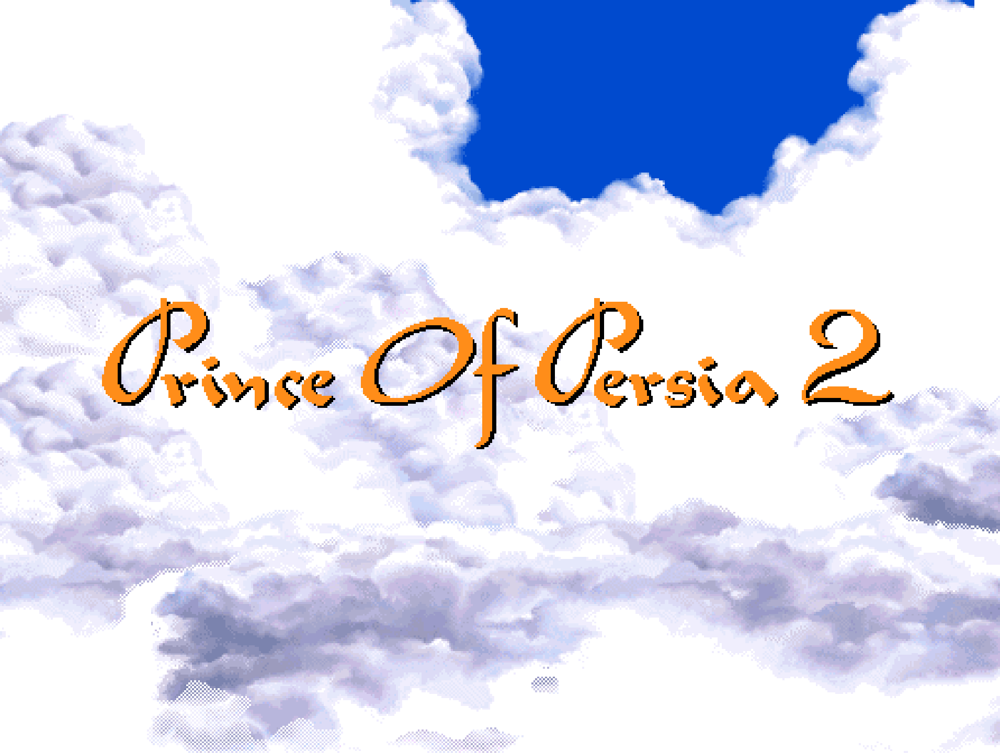
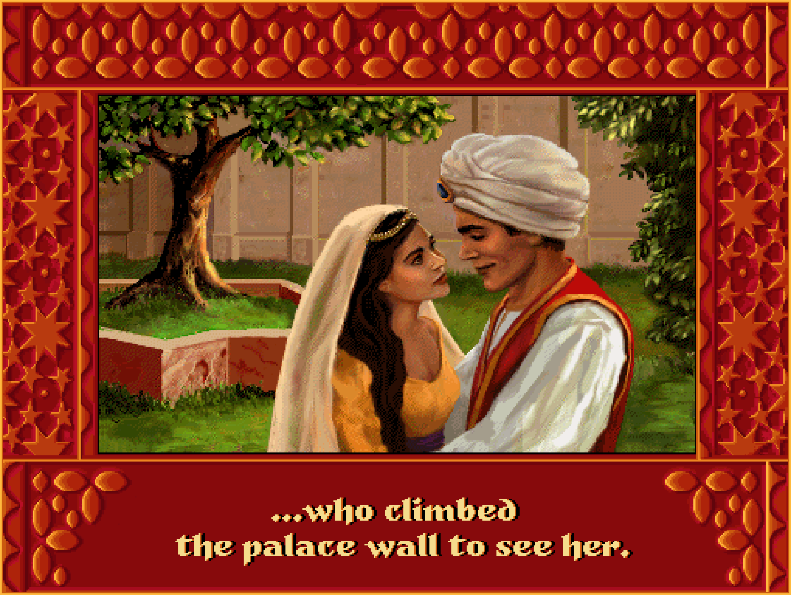
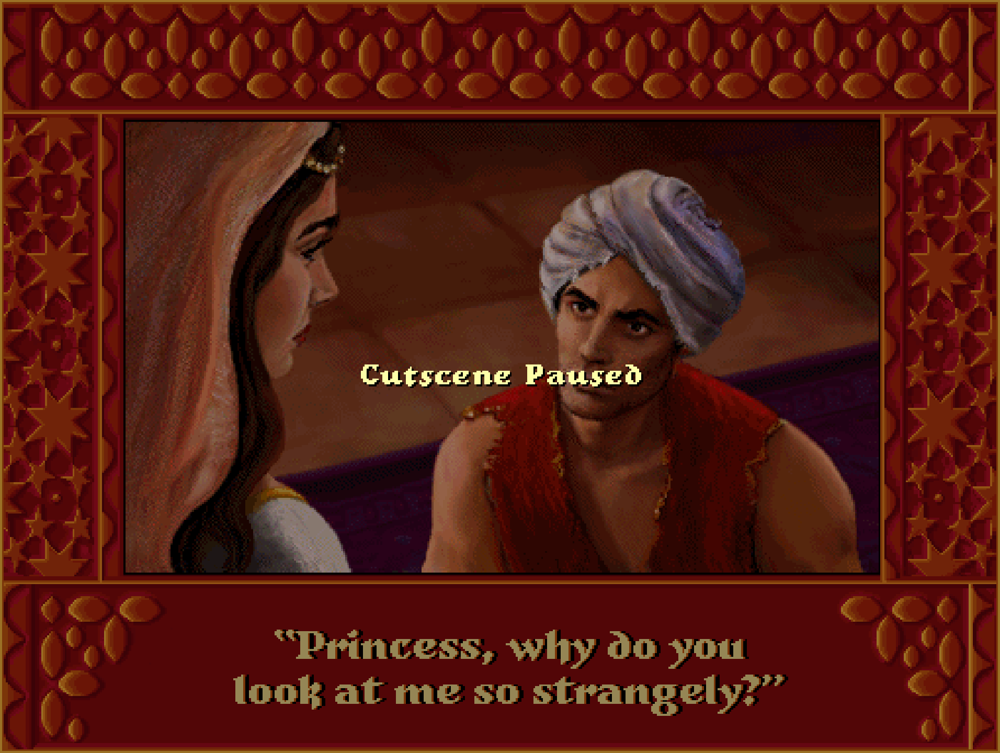
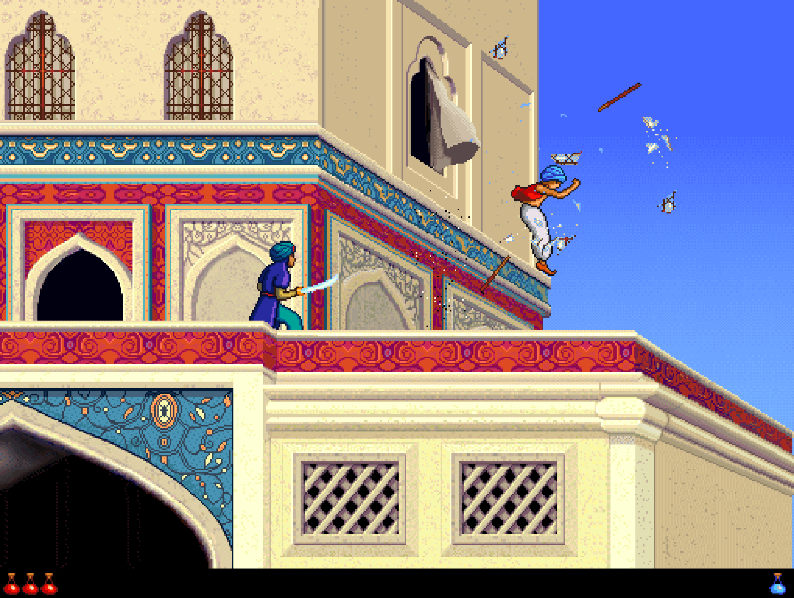
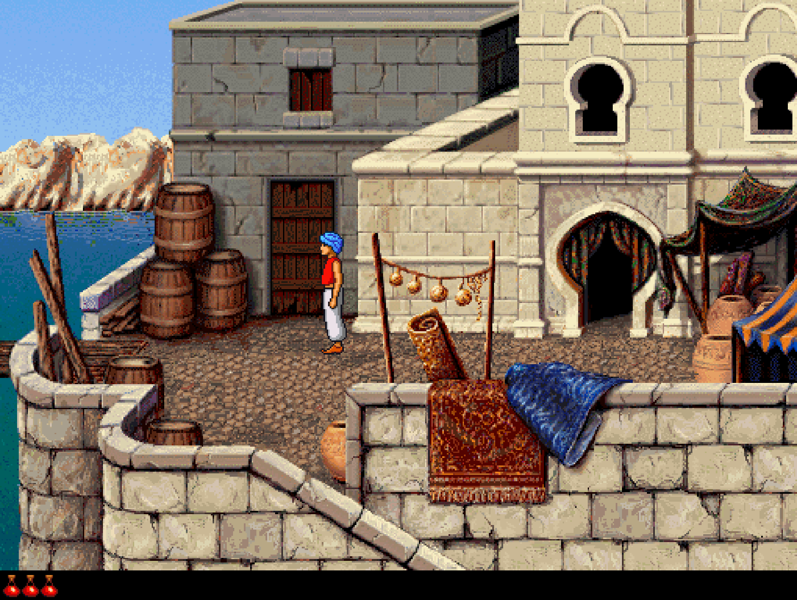
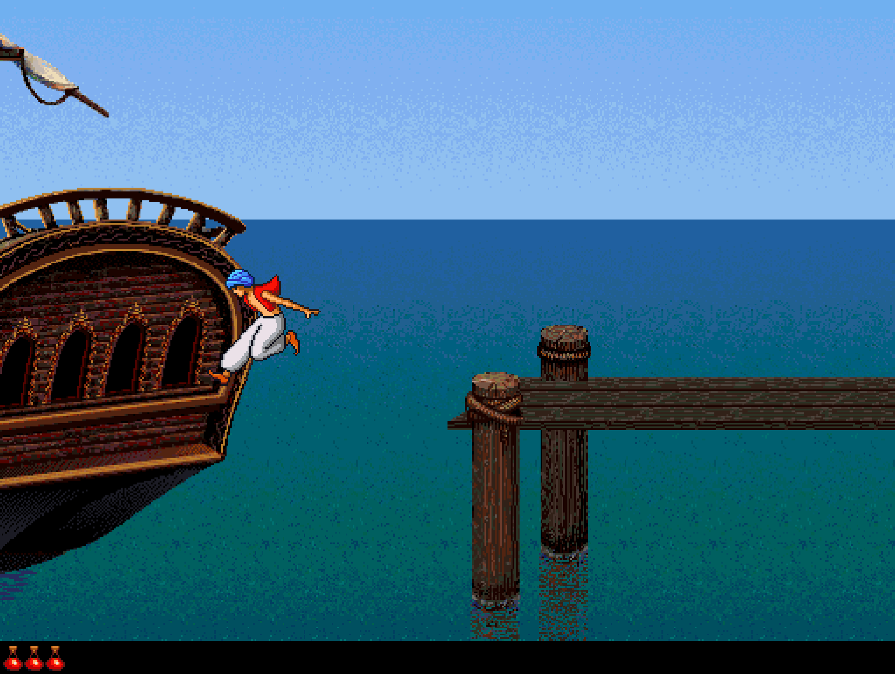

# Prince of Persia 2 Macintosh Native (WIP)

A work-in-progress native Windows port of the Macintosh version of Prince of
Persia 2. The goal is to preserve the original game's look, movement and gameplay
without requiring a Macintosh emulator.

It uses the original artwork, animation sequences and level data, with gameplay
logic being recovered from the Macintosh executable through reverse engineering.

## Screenshots

<table>
  <tr>
    <td width="50%"></td>
    <td width="50%"></td>
  </tr>
  <tr>
    <td></td>
    <td></td>
  </tr>
  <tr>
    <td></td>
    <td></td>
  </tr>
</table>

## Current Progress

- **Level 1:** Fully playable route, including combat, the checkpoint, boat
  escape and voyage to level 2.
- **Level 2:** Playable beach, shore and stone puzzle, with quicksand and the
  optional original copy protection.
- **Level 3:** Scenery recovered for all 32 rooms, including animated torches
  and entrance-door closure. Gameplay is still under development.
- **Presentation and Systems:** Original intro, demo and credits with music
  and sound effects; movement, sword combat, checkpoints, retry, fullscreen
  and menus.
- **Remaining Work:** Level-3 gameplay, potion rendering, guard-AI refinement
  and remaining differences from the Macintosh original.

## Quality of Life

- Automatic pause on focus loss; returning to the window, mouse clicks and
  system or multimedia keys do not resume the game.
- You can pause cutscenes now without skipping them.
- Confirmation before starting a new game, to prevent accidental progress loss.
- A 0.3-second filter for rapid repeated commands in the input queue, while
  preserving combinations of different commands.
- Original copy protection is optional.
- Clouds keep moving during the intro's fades.
- Clean PNG screenshots with a configurable folder and pixel-preserving scaling.

## Developer Tools

- Level and screen navigation through F2's Dev Mode.
- Direct access to parts of cutscenes, the demo and credits.
- Peaceful mode without guards and an optional debug status bar.

## Run

On 64-bit Windows, install Python 3.10 or newer with Tcl/Tk support, then
double-click `Launch.cmd`.
The launcher prepares a local `.venv` and installs its dependencies on the first run;
internet access is needed for that installation. It does not change your
global Python installation.

Original game files are not bundled. At the first launch, select your Macintosh
Prince of Persia 2 disk image. The importer extracts the resources, enemy data
and audio, then starts the game. Subsequent launches use those local files without
asking for the disk image again.

Compatible images contain an HFS volume, the named resource files below,
the `Prince of Persia 2` application, `DigiSnd.dat`, `MIDISnd.dat`,
`NISDIGI.dat` and `NISMIDI.dat`.
Raw or wrapped `.hfs`, `.hfv`, `.dsk`
and `.img` files can be used; the extension alone does not establish compatibility.
Files whose catalog or resource forks need HFS extents-overflow records are not
supported by this importer.

[PoPOT's Macintosh release page](https://www.popot.org/get_the_games.php?game=2_Mac)
lists an English disk image: [download `pop2.hfs` (17 MB)](https://www.popot.org/get_the_games/software/pop2.hfs).
Select the downloaded file when the launcher asks for a disk image.
PoPOT is an independent archive; availability there is not a redistribution
license. This project does not host or automatically download the game image.

For manual setup:

```powershell
py -3 -m venv .venv
.\.venv\Scripts\python.exe -m pip install -r requirements.txt
```

Run `.\.venv\Scripts\python.exe run_game.py` to import the game files or play.
`python run_game.py --check` checks dependencies and required files without
opening a window; `--check-dependencies` checks only the Python installation.
An activated virtual environment can use the shorter `python` commands below.

The project folder is self-contained: no sibling tools, ROM, Macintosh system
disk or other development folders are needed. Import creates these local files
in `assets/`:

- `Prince.rsrc`
- `Kid.rsrc`
- `Guard.rsrc`
- `Rooftops.rsrc`
- `Desert.rsrc`
- `Caverns.rsrc` and `caverns_entry.json` (all 32 level-3 scenery rooms)
- `NIS.rsrc` and `Title.rsrc`
- `enemy_profiles.json`
- `intro.json` (recovered scene instructions and audio markers)
- `ending.json` (voyage after level 1)
- `attract.json` (original level-one demo and credits program)
- `audio/` (original samples, voices, instruments and prepared music)

The same import can be performed without a file picker:

```powershell
.\.venv\Scripts\python.exe -m tools.extract_assets "C:\path\to\pop2.hfs"
```

The importer leaves the disk image unchanged and does not retain the game
executable or any ROM or system files. Generated game files are ignored by Git.
Existing installations missing the new scene resources will ask for the disk image once more.
Music is prepared during import using the bundled `smssynth` renderer and the
game's Macintosh instruments, not a General MIDI sound bank. Playback uses SDL
through pygame; the game does not generate diagnostic recordings.
The importer uses Unicorn to recover the scene coordinators' drawing and
timing calls and resolve the original recorded demo into actor states. The game
itself plays the resulting data natively, without a CPU emulator or the original
executable. Demo recovery adds time to the first import, not to later launches.

## Controls

| Key | Action |
| --- | --- |
| Space during intro | Skip to level 1 |
| Space during voyage | Skip to the level-2 arrival |
| Gameplay key during demo or credits | Start a new game |
| Left / Right | Run, turn, or move in sword mode |
| Shift + Left / Right | Careful step |
| Up | Jump, climb, or block in sword mode |
| Direction + Up | Forward or running jump |
| Down | Crouch, descend a ledge, or sheath the sword |
| Shift | Retain a ledge grip |
| Ctrl | Draw the sword or attack |
| Esc | Pause; text keys or arrows resume (not mouse clicks, modifiers, F-keys, multimedia, Insert/Delete/Home/End/Page Up/Page Down or system shortcuts) |
| Alt + Enter | Toggle fullscreen |
| F1 | Game menu with command shortcuts |
| Alt + N | New game, after confirmation |
| Alt + R | Restart from the latest checkpoint or level start |
| Alt + T | Toggle all sound |
| Alt + M | Toggle ambient music |
| Alt + V | About the port |
| F2 | Dev Mode: levels 1-3, intro/demo playback and display controls |
| F8 | Save a clean PNG screenshot to the configured folder |
| Any key after death | Retry from the checkpoint or level start |

The game menu accepts mouse, arrows and Tab/Shift+Tab; Enter/Space activates
the selected option. New game defaults to Cancel. Escape backs out without
discarding progress. Save/Open and Hall of Fame
are shown disabled until those systems are implemented. There are no
Alt+Q or Alt+F commands; fullscreen remains Alt+Enter.
The original manual-symbol challenge is enabled by default. The F1 option
`Copy protection` disables only that challenge, not the stone puzzle.

The developer menu accepts mouse, Tab/Shift+Tab and arrow navigation.
Its `Level` and `Screen` selectors include the playable routes in levels 1-2
and scenery previews of all 32 level-3 rooms. Level-3 mechanisms and skeletons
are not implemented yet. Choose `2 (Stones)` to jump directly to the level-2
puzzle without replaying the beach arrival. Left/Right moves between `Go to screen`
and `Resume`; Enter/Space activates
a control. Focus the tab row to switch between `Level`, `Playback` and `Display`
with Left/Right. Escape closes the dropdown before closing the menu.
Screen jumps also set the latest checkpoint along the selected route. During
the attract cycle, only playback and display controls are available. Playback
selects a sequence first, then a story part, animated title, demo screen or
credits page. `Next part` follows playback order across sequence boundaries.
The Windows debug status bar is hidden by default; enable it in `Display`.
`F2 > Display` also selects the screenshot folder and PNG size. `Save PNG` or
F8 captures the game image without window borders, fullscreen letterboxing,
menus or pause overlays. The original in-game HUD remains part of the image.
Sizes range from native 510 x 384 to 4x, using nearest-neighbor integer scaling;
the default is 3x (1530 x 1152). Folder and size are remembered locally in
`rendered/screenshot-settings.json`. The default folder is `rendered/screenshots/`;
captures use unique timestamped filenames and are not published by Git.
`python run_game.py --peaceful` starts with guards disabled and terrain intact.

## Development

[Level loading](docs/LEVEL_LOADING.md) describes the separation between original
level data, gameplay state, scenery and the window host.
[Level transitions](docs/LEVEL_TRANSITION.md) documents the boat-to-beach sequence.
[Desert recovery](docs/DESERT_RECOVERY.md) covers the stones and manual challenge.
[Cavern recovery](docs/CAVERN_RECOVERY.md) tracks level-3 scenery and remaining mechanics.

```powershell
python -m pip install -r requirements-dev.txt
python -m ruff check --select F,E9 .
python -m unittest -q tests.test_bootstrap tests.test_extract_assets tests.test_extract_audio tests.test_extract_intro tests.test_extract_attract tests.test_recorded_game tests.test_attract tests.test_intro tests.test_audio tests.test_playback_navigation tests.test_mac_resources tests.test_run_game tests.test_setup_game tests.test_recovery_catalog tests.test_project_layout tests.test_window_controls tests.test_bitmap_presenter tests.test_game_menu.GameMenuModelTests tests.test_palettes tests.test_game_session tests.test_level_ending
python -m tools.recovery_catalog --check
python -m unittest -q tests.test_desert tests.test_caverns
python -m unittest -q tests.test_screenshots
```

These checks run without original game files and are used in GitHub Actions.
After importing the game files, run the full gameplay suite with
`python -m unittest discover -s tests -t . -q`.

Python 3.10 with Pillow 10.4 and 12.3 has been tested. The gameplay suite needs
the generated files in `assets/`, but not external research folders.
An optional developer test re-extracts enemy
data from the original Macintosh game files and checks that it matches
`assets/enemy_profiles.json`. Without those original files, this test is skipped.
To enable it, set `POP2_RESEARCH_DIR` to a recovery directory containing
`resource_forks/`.
The routine catalog can also be rebuilt from that directory with
`python -m tools.recovery_catalog --source PATH_TO_RECOVERY`.

The old isolated animation comparison remains available through
`python -m pop2.scene_prototype --no-guard`. It is a test harness with simplified
opening-room boundaries, not the playable terrain mode.

The launcher stays in the project root. Runtime modules, tests and research
utilities are separate:

```text
Launch.cmd          Windows launcher
bootstrap.py        Local environment setup
run_game.py         Installation checks and game entry point
pop2/               Game runtime and first-run import window
tests/              Regression tests
tools/              Game-file import and recovery utilities
docs/               Technical notes and routine catalog
assets/             Locally imported game files (not bundled)
vendor/             Import-time MIDI renderer and its license notices
.github/            Automated checks
```

[Behavior map](docs/BEHAVIOR_MAP.md), [rule recovery index](docs/RECOVERY_INDEX.md),
[collision notes](docs/COLLISION_RECOVERY.md), [enemy AI notes](docs/AI_RECOVERY.md),
[harbor and ship notes](docs/HARBOR_RECOVERY.md),
[audio notes](docs/AUDIO_RECOVERY.md), [death/checkpoint notes](docs/REBIRTH_RECOVERY.md),
[intro notes](docs/INTRO_RECOVERY.md),
[demo and credits notes](docs/ATTRACT_RECOVERY.md),
[game commands](docs/GAME_COMMANDS.md),
[development history](docs/DEVELOPMENT_HISTORY.md).

Source addresses in comments identify the recovered Macintosh routine behind a
condition. Passing tests cover those documented subsets, not full-game parity.

## License

Newly written port code is licensed under [MIT](LICENSE). Original game content
is not covered by that license. See [third-party notices](THIRD_PARTY_NOTICES.md)
for the scope and dependency licenses.
