# Cavern Artwork Comparisons

Original Macintosh scenery and the approved artwork retouches in the port.

The 22 rooms below include rooms that received only the entrance/exit doorway-edge retouch. Some rooms received both wall and doorway retouches.

| Level | Retouched rooms |
| --- | ---: |
| 3 | 5 |
| 4 | 8 |
| 5 | 9 |

The scenery is shown without characters, with entrance doors closed. In level 5, room 7, the stone gate is open to reveal the wall behind it.

[Back to the README](../README.md#cavern-artwork)

## Level 3

### Room 1

<table>
  <tr><th width="50%">Macintosh</th><th width="50%">Port</th></tr>
  <tr>
    <td>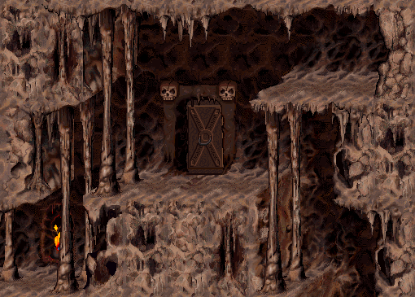</td>
    <td>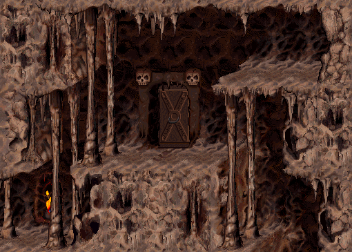</td>
  </tr>
</table>

### Room 2

<table>
  <tr><th width="50%">Macintosh</th><th width="50%">Port</th></tr>
  <tr>
    <td>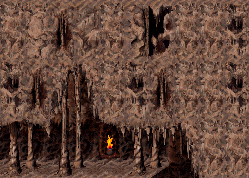</td>
    <td></td>
  </tr>
</table>

### Room 13

<table>
  <tr><th width="50%">Macintosh</th><th width="50%">Port</th></tr>
  <tr>
    <td>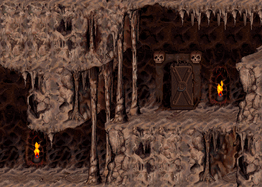</td>
    <td></td>
  </tr>
</table>

### Room 28

<table>
  <tr><th width="50%">Macintosh</th><th width="50%">Port</th></tr>
  <tr>
    <td>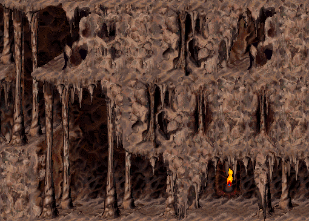</td>
    <td>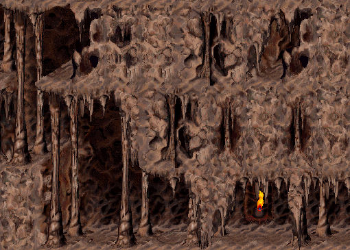</td>
  </tr>
</table>

### Room 30

<table>
  <tr><th width="50%">Macintosh</th><th width="50%">Port</th></tr>
  <tr>
    <td>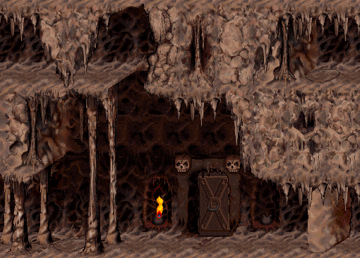</td>
    <td></td>
  </tr>
</table>

## Level 4

### Room 1

<table>
  <tr><th width="50%">Macintosh</th><th width="50%">Port</th></tr>
  <tr>
    <td></td>
    <td>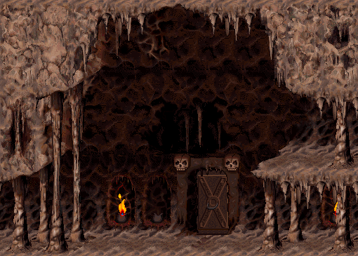</td>
  </tr>
</table>

### Room 5

<table>
  <tr><th width="50%">Macintosh</th><th width="50%">Port</th></tr>
  <tr>
    <td>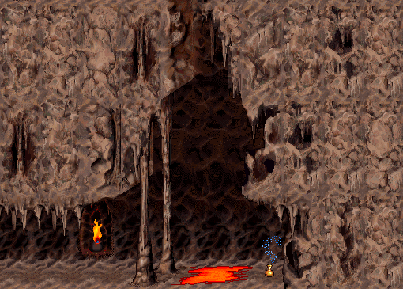</td>
    <td></td>
  </tr>
</table>

### Room 12

<table>
  <tr><th width="50%">Macintosh</th><th width="50%">Port</th></tr>
  <tr>
    <td>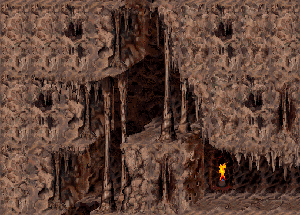</td>
    <td></td>
  </tr>
</table>

### Room 14

<table>
  <tr><th width="50%">Macintosh</th><th width="50%">Port</th></tr>
  <tr>
    <td></td>
    <td>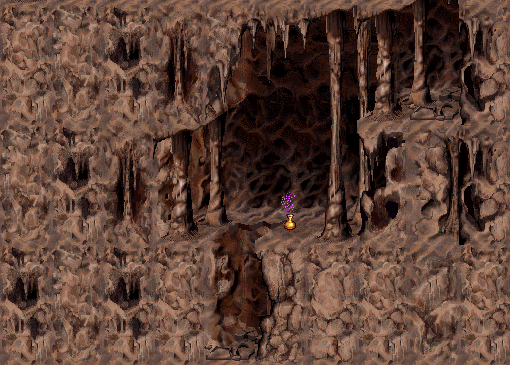</td>
  </tr>
</table>

### Room 22

<table>
  <tr><th width="50%">Macintosh</th><th width="50%">Port</th></tr>
  <tr>
    <td>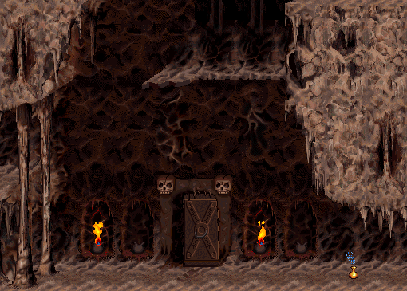</td>
    <td></td>
  </tr>
</table>

### Room 23

<table>
  <tr><th width="50%">Macintosh</th><th width="50%">Port</th></tr>
  <tr>
    <td>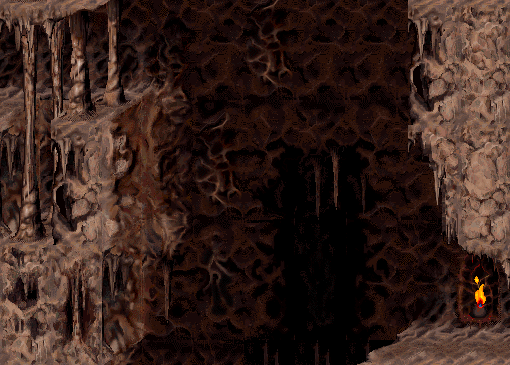</td>
    <td></td>
  </tr>
</table>

### Room 26

<table>
  <tr><th width="50%">Macintosh</th><th width="50%">Port</th></tr>
  <tr>
    <td>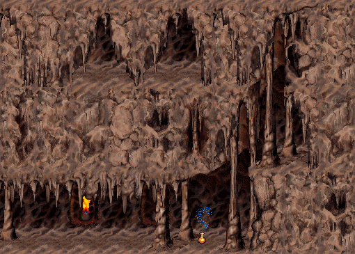</td>
    <td></td>
  </tr>
</table>

### Room 28

<table>
  <tr><th width="50%">Macintosh</th><th width="50%">Port</th></tr>
  <tr>
    <td>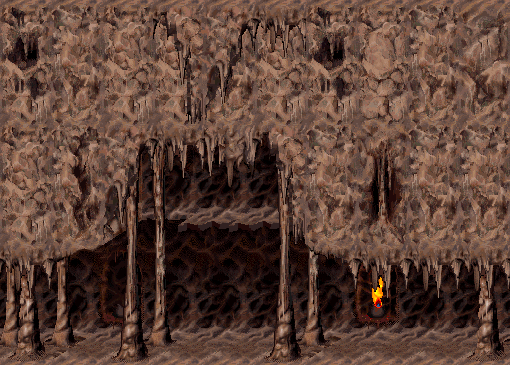</td>
    <td></td>
  </tr>
</table>

## Level 5

### Room 1

<table>
  <tr><th width="50%">Macintosh</th><th width="50%">Port</th></tr>
  <tr>
    <td>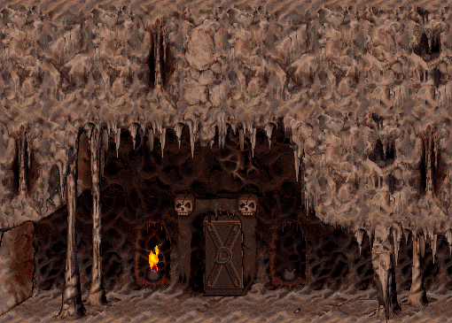</td>
    <td></td>
  </tr>
</table>

### Room 6

<table>
  <tr><th width="50%">Macintosh</th><th width="50%">Port</th></tr>
  <tr>
    <td></td>
    <td>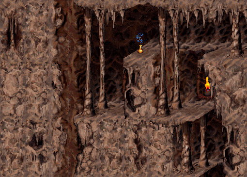</td>
  </tr>
</table>

### Room 7

<table>
  <tr><th width="50%">Macintosh</th><th width="50%">Port</th></tr>
  <tr>
    <td>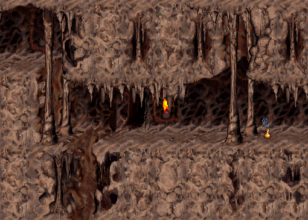</td>
    <td></td>
  </tr>
</table>

### Room 14

<table>
  <tr><th width="50%">Macintosh</th><th width="50%">Port</th></tr>
  <tr>
    <td>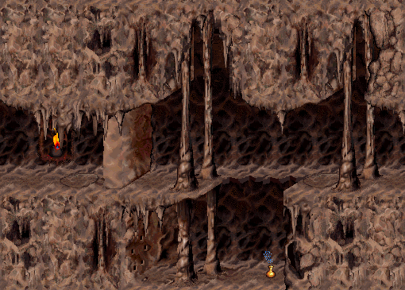</td>
    <td></td>
  </tr>
</table>

### Room 15

<table>
  <tr><th width="50%">Macintosh</th><th width="50%">Port</th></tr>
  <tr>
    <td>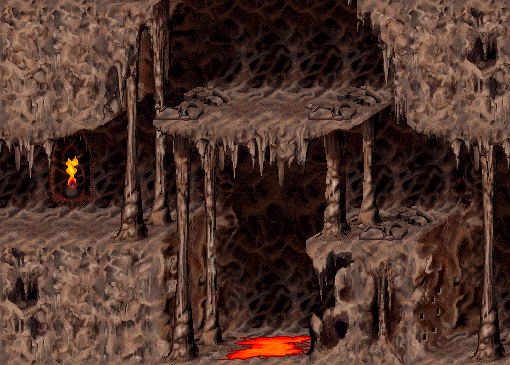</td>
    <td></td>
  </tr>
</table>

### Room 16

<table>
  <tr><th width="50%">Macintosh</th><th width="50%">Port</th></tr>
  <tr>
    <td></td>
    <td>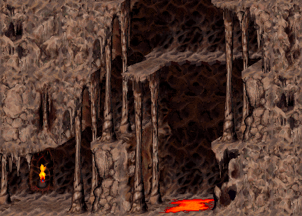</td>
  </tr>
</table>

### Room 17

<table>
  <tr><th width="50%">Macintosh</th><th width="50%">Port</th></tr>
  <tr>
    <td>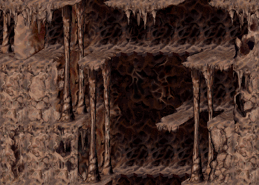</td>
    <td>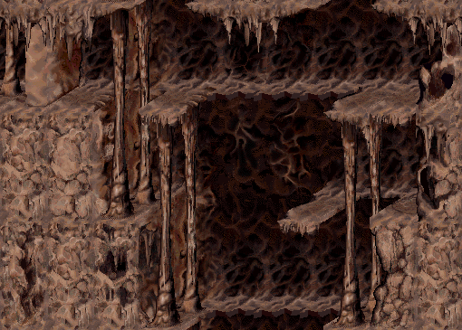</td>
  </tr>
</table>

### Room 23

<table>
  <tr><th width="50%">Macintosh</th><th width="50%">Port</th></tr>
  <tr>
    <td></td>
    <td>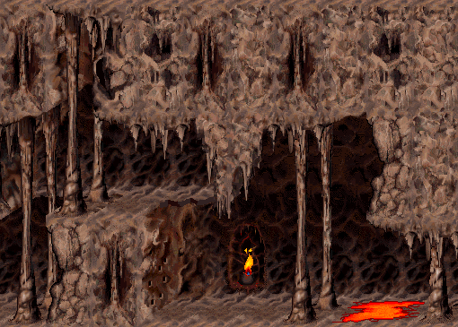</td>
  </tr>
</table>

### Room 25

<table>
  <tr><th width="50%">Macintosh</th><th width="50%">Port</th></tr>
  <tr>
    <td></td>
    <td>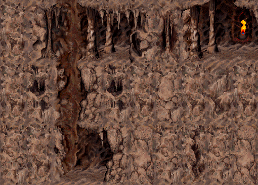</td>
  </tr>
</table>
